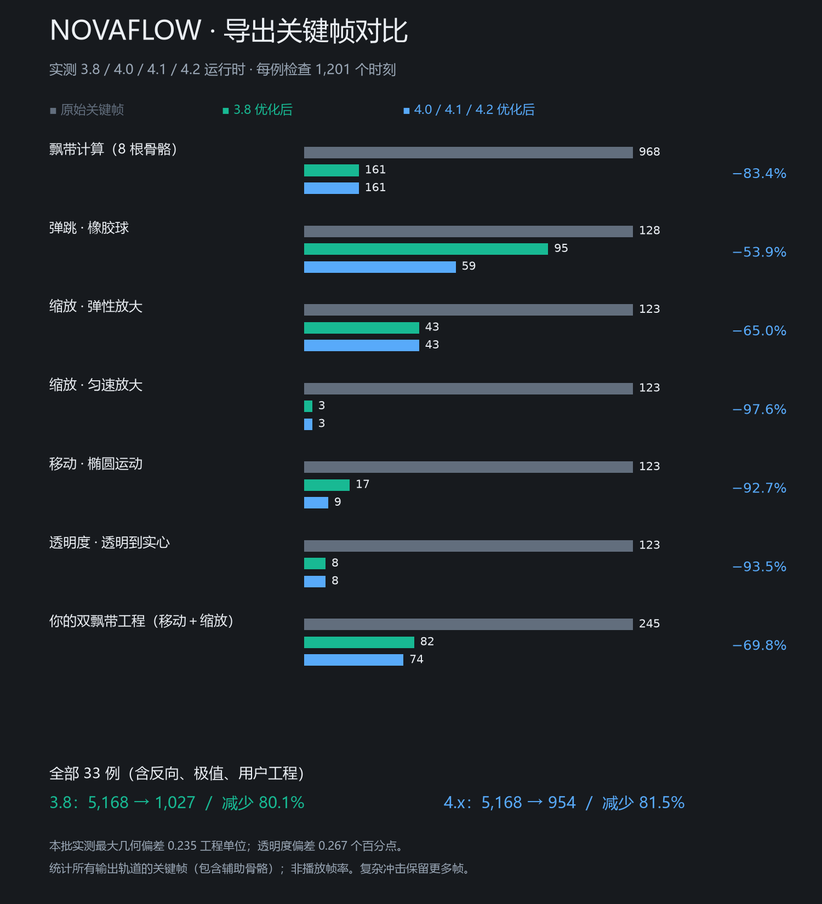

# Spine 动画导出减帧验收

正式链：`novaflow-brand-runtime.js → buildSkeletonSpineExportJson → NovaFlowSpineExportOptimizer.optimize`。覆盖飘带旋转、动画计算的弹跳/移动位移、缩放及透明度。只处理导出副本，编辑器原工程保持不变。

## 最终方案

- 同时比较线性精简与按运行时插值方式拟合的贝塞尔分段，保留减少关键帧且 JSON 更小的结果。保留首尾时间，事件、附件、绘制顺序、约束与手工曲线不做抽帧；多圈旋转不合成有歧义的大角度跨度。
- 3.8 比较合并 XY 与辅助骨骼分轴。只有包含骨骼定义、各动画及蒙皮索引的完整候选文件更小，且总关键帧更少，才使用辅助骨骼。移动 X 放在父级；缩放 X 放在保留原旋转、剪切、平移的辅助层，原骨骼控制缩放 Y。其他动画的变换同步搬移，蒙皮权重仍引用同名原骨骼。
- 有 IK/变换/路径约束、皮肤专用骨骼或不适合分解的继承模式时，保留层级并做普通曲线精简。已经带本工具辅助骨骼的工程不再继续加层。
- 4.0/4.1/4.2 比较原生合并轴与分离轴，不增加辅助骨骼。保留原生每通道绝对时间/数值贝塞尔格式，修复旧流程统一清掉 4.x 曲线的问题。
- 局部误差预算：位移 0.35、旋转/剪切 0.035 度、缩放 0.0006、颜色 0.75/255；除颜色外按骨架深度收紧。检查源线性节点与输出运行时贝塞尔十段折线的所有拐点，并为 Float32 留余量。预算不是任意工程的屏幕像素保证。

统一使用 3.8 辅助骨骼并不是更好的输出策略：椭圆运动例子原始 123 帧，3.8 分轴为 17 帧且增加 1 根骨骼，4.x 原生输出为 9 帧且无需增加骨骼。简单同向缩放无需辅助骨骼即可从 123 减到 3 帧。

## 实测结果

每版本 33 个样例，包括全部计算预设、缩放/移动反向、组合极值、8 根骨骼飘带和用户双飘带加权网格工程；每例在官方运行时检查 1,201 个时刻，比较世界位置、变换后几何点、网格顶点及 RGBA。

| 版本 | 原始关键帧合计 | 优化后合计 | 减少 |
| --- | ---: | ---: | ---: |
| 3.8 | 5,168 | 1,027 | 80.1% |
| 4.0 | 5,168 | 954 | 81.5% |
| 4.1 | 5,168 | 954 | 81.5% |
| 4.2 | 5,168 | 954 | 81.5% |

本批最大几何偏差 0.236 工程单位以内，RGBA 偏差 0.267 个百分点以内。统计包含辅助骨骼轨道；总量不代表每个效果均可减少 80%，高频冲击与大幅独立 XY 会保留更多帧。图中每组以该例原始帧数为基准，横向长度不跨组比较。



另测：3.8 缩放辅助骨骼在旋转、剪切、负设置缩放和其他动画下等价；加权顶点索引重映射；约束层级保护；720 度旋转；手工曲线与 stepped 原样保留。

页面实际保存的 JSON+ATLAS+PNG 也回放对照：3.8 最大几何偏差 0.148，4.0 最大几何偏差 0.154。此本地验收只把系统目录选择器换成指定测试目录写入，导出按钮、工程构造器、文件名及素材处理均走正式代码。测试文件在本机 `C:/Users/jiang/Documents/Codex/2026-09-25/za/outputs/export-optimization/`。

## 版本与部署边界

这是按**工程原版本**优化导出，不是跨版本工程转换器。发现并修正共享粒子导出 UI 在骨骼场景中显示可选版本、但实际没有转换工程的误导行为：现在明确显示并锁定真实原版本。Spine 各大/小版本数据与运行时需匹配，不能把 3.8 文件只改版本号冒充 4.x。

已更新维护源码及本机 web-dist/worker renderer；未发布线上，未打安装包。验收时先保存当前调整，再刷新本机测试页，导入对应版本工程，计算并保存动画后使用 Spine 导出。

检查通过：计算/导出/飘带专项合计 172 项；`sync:runtime`、`check:runtime`、`check:entry`（189 项入口检查）通过。

## 复现

基础测试：

```powershell
node --test novaflow-web/tests/e2e/spine-export-optimizer.test.mjs
```

3.8 与 4.0 使用仓库已带官方运行时。额外 4.1/4.2 测试使用官方 npm 包的独立 IIFE（仅测试，不改变应用运行时）：`@esotericsoftware/spine-core@4.1.56/dist/iife/spine-core.js`、`@esotericsoftware/spine-core@4.2.120/dist/iife/spine-core.js`，分别保存为 `spine-core-4.1.js`、`spine-core-4.2.js`，用 `SPINE_EXTRA_RUNTIME_DIR` 指定目录。

可选 `SPINE_USER_FIXTURE` 指向用户 test.json；`SPINE_EXPORT_REPORT` 指定统计 JSON 输出目录；`SPINE_UI_EXPORT_DIR` 指向上述实际页面导出的验收目录。绘图：

```powershell
python novaflow-web/tests/helpers/plot-export-comparison.py <统计目录>
```

绘图依赖 matplotlib 和微软雅黑，图表数据来自 `comparison.json`。保留误差受控的结果，不声称数学意义上全局最少关键帧。
